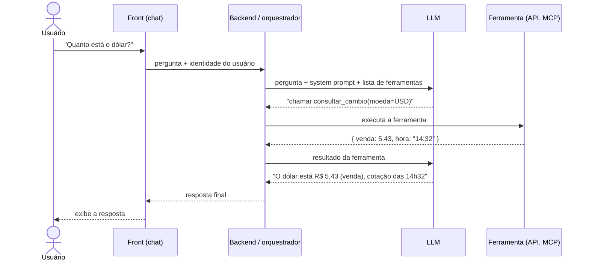

# 05. Anatomia de um sistema com IA

> Usar um chat de IA é uma coisa; trabalhar num **produto** que tem IA dentro é outra. Este módulo mostra as peças de um sistema com IA e onde cada profissão atua. O exemplo é um assistente que responde "quanto está o dólar?".

## O fluxo de uma pergunta

> Para ver o diagrama no VS Code, instale a extensão **Markdown Preview Mermaid Support**.

## O ponto mais importante

**O LLM não sabe a cotação.** Ele só sabe:

1. **Decidir** qual ferramenta chamar e com quais parâmetros.
2. **Redigir** a resposta com o que recebeu.

Por isso surgem duas famílias de erro que não existem num sistema comum:

| Tipo de erro | Exemplo |
|--------------|---------|
| **Erro de decisão** | Chamou a ferramenta errada, passou parâmetro errado (EUR em vez de USD) ou respondeu "de cabeça" sem chamar nada |
| **Erro de redação** | Recebeu R$ 5,43 e escreveu R$ 5,34; inventou um dado que não veio; omitiu algo importante |

## As camadas e quem cuida de cada uma

| Camada | Natureza | Dev | Arquiteto | QA | DevOps / SRE |
|--------|----------|-----|-----------|----|--------------|
| Front (chat) | Determinística | Streaming, mensagens de erro | Experiência e limites | UI, acessibilidade | Disponibilidade |
| Backend / orquestrador | Determinística | Montar o prompt, chamar o modelo, tratar erros | Escolha de modelo, fallback, custo | Teste de API e integração | Deploy, segredos, escala |
| LLM | **Não determinística** | Prompt, parâmetros, ferramentas expostas | Qual fornecedor, onde os dados trafegam | **Evals** (taxa de acerto) | Limites de uso, latência |
| Ferramentas (APIs, MCP) | Determinística | Construir e documentar | Contratos, autorização | Teste de API | Monitorar e versionar |
| Logs e traces | Determinística | Registrar cada passo | Auditoria e retenção | Evidência de bug | Observabilidade e alertas |
| Segurança | Mista | Validar entradas e saídas | Identidade e permissões | Red teaming | Segredos, rede, incidentes |

A regra que vale para todos: **o que é determinístico se testa e se opera como sempre; o que passa pelo LLM precisa de medição estatística e de revisão humana.**

## Quatro decisões de arquitetura que afetam todo mundo

1. **Qual identidade a IA usa ao consultar dados?** A do usuário logado (mais seguro) ou um usuário de serviço que vê tudo (arriscado: a restrição fica só no prompt).
2. **A IA só lê ou também altera dados?** Ações que alteram exigem confirmação humana.
3. **O que fica registrado?** Sem trace de pergunta, ferramentas chamadas e resposta, não há como investigar um erro.
4. **O que acontece quando o modelo ou a ferramenta falha?** A resposta certa é "não consegui", nunca um valor inventado.

## Aprofunde na sua trilha

- QA: [Mapa da jornada](<../../02 - Trilha IA QA/01 - Estudo/01 - Mapa Da Jornada.md>) com o caso bancário e o tipo de teste de cada etapa.
- DEV: [API e tool calling](<../../03 - Trilha IA DEV/01 - Estudo/05 - API E Tool Calling.md>), o laço de ferramentas em código.

## Checklist de aprendizado

- [ ] Consigo desenhar o fluxo de uma pergunta de memória
- [ ] Entendo que o LLM não "sabe" os dados: ele chama ferramentas
- [ ] Sei diferenciar erro de decisão de erro de redação
- [ ] Sei dizer qual camada é responsabilidade da minha função
- [ ] Sei as quatro perguntas de arquitetura para fazer em qualquer projeto com IA
