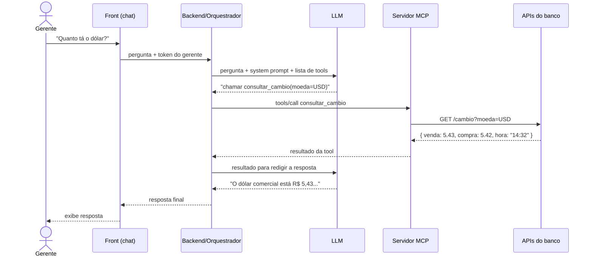

# 01. O mapa da jornada

> Assim como numa compra online existe cadastro → login → produto → carrinho → pagamento → confirmação → entrega, um assistente com IA também tem uma jornada. Cada etapa pode falhar e pode ser testada.

> A visão genérica deste fluxo, com o papel de cada profissão, está em [05 - Anatomia De Um Sistema Com IA](<../../01 - Trilha IA Geral/01 - Estudo/05 - Anatomia De Um Sistema Com IA.md>). Aqui ele é aplicado ao caso bancário, com o tipo de teste de cada etapa.

## O fluxo de "quanto tá o dólar?"

```
Gerente (front/chat)
   │ 1. digita a pergunta (já autenticado)
   ▼
Backend / orquestrador
   │ 2. envia ao LLM: pergunta + instruções do sistema (system prompt) + lista de ferramentas
   ▼
LLM (o "cérebro": GPT, Claude, Gemini...)
   │ 3. interpreta a intenção e decide: "vou chamar consultar_cambio(moeda=USD)"
   ▼
MCP Client → MCP Server
   │ 4. o servidor MCP traduz isso numa chamada real
   ▼
APIs / sistemas do banco (câmbio, crédito, cadastro)
   │ 5. devolvem os dados
   ▼
LLM
   │ 6. transforma o dado bruto em texto:
   │    "O dólar comercial está R$ 5,43 (venda), cotação das 14h32"
   ▼
Front exibe a resposta + logs/auditoria registram tudo
```

### Mesmo fluxo em Mermaid (renderiza no VS Code com extensão de preview Mermaid)



## O ponto mais importante

**O LLM não sabe a cotação nem se o cliente tem crédito.** Ele só sabe:

1. **Pedir** a informação para uma ferramenta.
2. **Redigir** a resposta com o que recebeu.

Isso cria duas famílias de erros que não existem numa aplicação comum:

| Tipo de erro | Exemplo |
|--------------|---------|
| **Erro de decisão** | Chamou a ferramenta errada, passou parâmetro errado (EUR em vez de USD) ou nem chamou nada e respondeu "de cabeça" |
| **Erro de redação** | Recebeu R$ 5,43 e escreveu R$ 5,34; inventou um dado que não veio (alucinação); omitiu informação importante |

## Onde cada etapa pode falhar

| Etapa | O que pode dar errado | Tipo de teste |
|-------|-----------------------|---------------|
| 1. Front | Layout, envio, streaming da resposta, mensagens de erro | UI / Figma / funcional |
| 2. Backend | Token não repassado, prompt montado errado, timeout | API / integração |
| 3. LLM decide | Ferramenta errada, parâmetros errados, ambiguidade ignorada | **Eval** |
| 4. MCP | Schema inválido, erro não tratado, autorização ausente | **API (determinístico)** |
| 5. APIs do banco | Dado indisponível, desatualizado, cliente inexistente | API / integração |
| 6. LLM redige | Número trocado, alucinação, dado a mais (vazamento) | **Eval** |
| Logs | Sem rastreabilidade, dados sensíveis gravados em log | Auditoria / segurança |

## Checklist de aprendizado

- [ ] Consigo desenhar este fluxo de memória
- [ ] Entendo que o LLM não "sabe" os dados, ele chama ferramentas
- [ ] Sei diferenciar erro de decisão de erro de redação
- [ ] Validei com o time se a arquitetura real do projeto é parecida com esta
